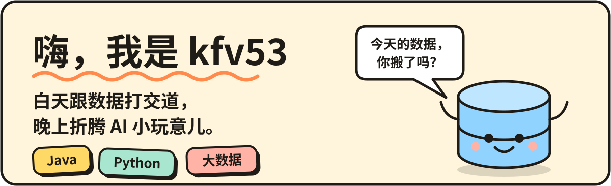
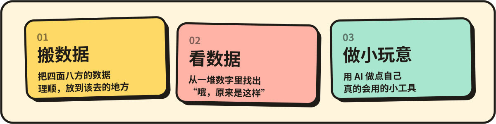

  

## 简单认识一下

白天是个大数据开发，每天的活就是跟各种数据打交道。

下班以后喜欢折腾 AI 应用，前端后端自己一把抓，做出来能用就很开心。

最近比较上头的三件事：数据怎么整合才顺手，数据怎么看出门道，AI 怎么才能真的帮上忙。

## 我平时在干嘛

  

## 常用的家伙

Java 和 Python 最顺手，大数据那一套主流框架也都用得熟。

## 找我玩

想聊数据、聊 AI 小工具，或者单纯认识一下，欢迎来 Issues 留言。
